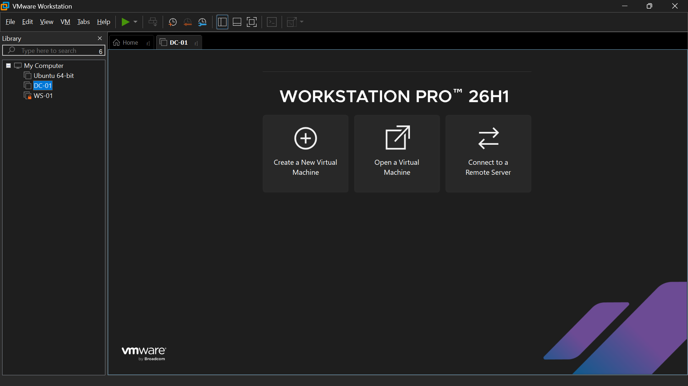
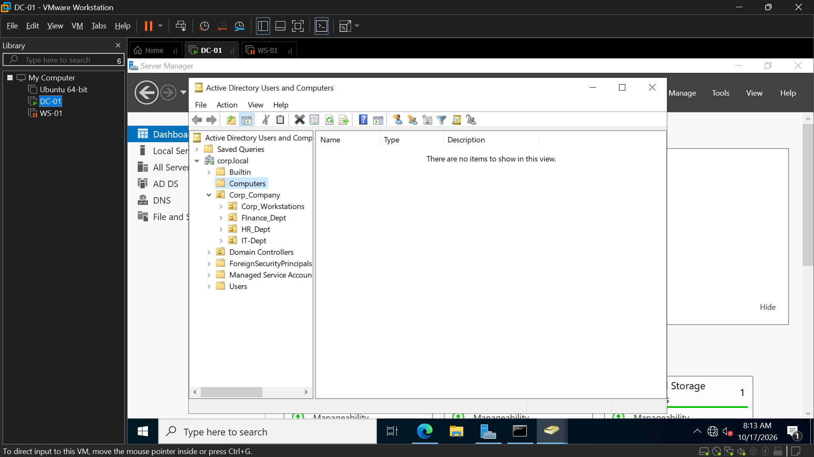
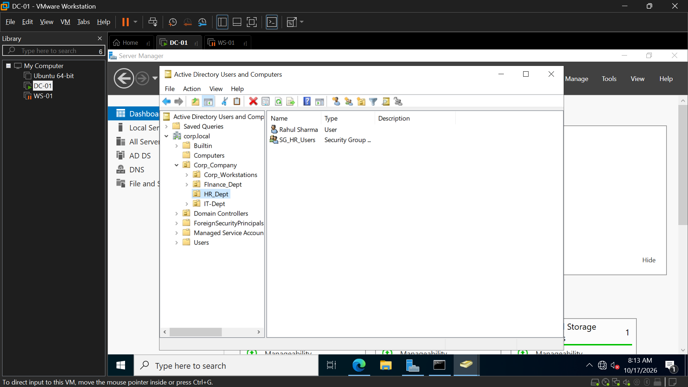
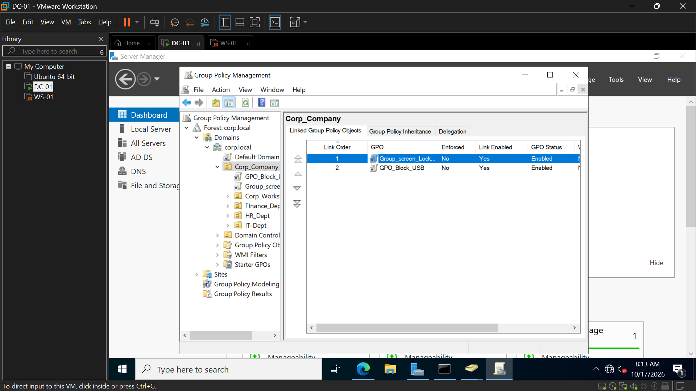
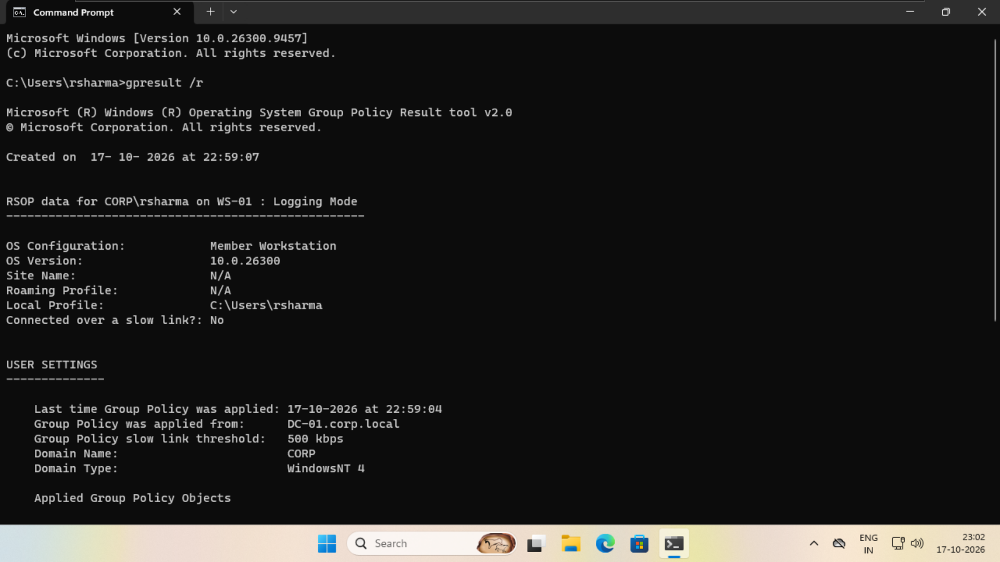
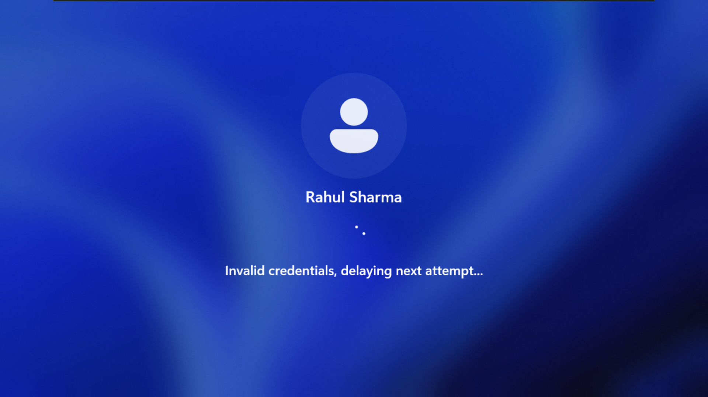
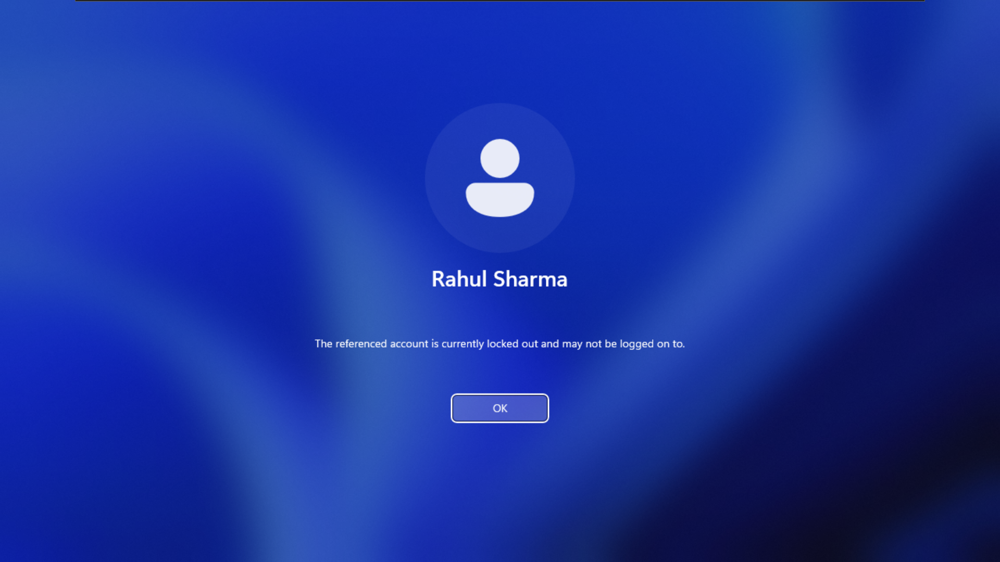

<div align="center">

# 🏢 Enterprise Active Directory & Endpoint Policy Lab

### Simulated On-Premises Identity & Security Infrastructure

[](https://www.vmware.com/products/workstation-pro.html)
[](https://www.microsoft.com/en-us/windows-server)
[](https://www.microsoft.com/en-us/windows/windows-11-enterprise)
[](#)

</div>

---

## 📋 Executive Summary

This project demonstrates the end-to-end deployment and administration of an **enterprise-grade on-premises IT environment** built entirely inside an isolated virtual network using **VMware Workstation Pro**. The lab replicates real-world corporate infrastructure — from standing up a **Windows Server 2022 Domain Controller** and **Active Directory Domain Services**, to enforcing compliance-driven **Group Policy Objects**, and executing **L1/L2 Help Desk incident remediation workflows**.

Every configuration step — OU design, GPO deployment, DNS resolution, domain joining, bulk user provisioning, policy verification, and account lockout remediation — was performed manually and validated with live diagnostic tools, providing a complete portfolio-ready demonstration of Desktop Support and Systems Engineering competencies.

---

## 🖥️ Architecture & Topology

The lab consists of two virtual machines running on a **NAT-segmented virtual network** (`192.168.67.0/24`), simulating a corporate LAN with centralized identity and policy management.

| Attribute | DC-01 (Domain Controller) | WS-01 (Client Endpoint) |
|:---|:---|:---|
| **Operating System** | Windows Server 2022 Standard (Desktop Experience) | Windows 11 Enterprise |
| **Hostname** | `DC-01` | `WS-01` |
| **Server Roles** | AD DS, DNS Server | Member Workstation |
| **IP Address** | `192.168.67.10/24` (Static) | DHCP / Static |
| **Preferred DNS** | `127.0.0.1` (Loopback) | `192.168.67.10` (→ DC-01) |
| **Domain FQDN** | `corp.local` | Joined to `corp.local` |

<br>

<div align="center">

> **Fig. 1** — VMware Workstation Pro library showing the lab topology: DC-01 (Domain Controller), WS-01 (Client), and an auxiliary Ubuntu VM.



</div>

---

## 🗂️ Active Directory Architecture — AGDLP & Tiered OU Structure

The directory hierarchy follows the **AGDLP (Account → Global → Domain Local → Permission)** model, a Microsoft best-practice for scalable access management. A root Organizational Unit encapsulates all departmental containers, enabling OU-level GPO linkage and delegated administration.

```
corp.local (Domain Root)
│
├── 📁 Corp_Company                  ← Root OU (GPO linkage point)
│   ├── 📁 IT_Dept                   ← IT Department
│   │   └── 👥 SG_IT_Users           ← Security Group (Global)
│   │
│   ├── 📁 HR_Dept                   ← Human Resources
│   │   └── 👥 SG_HR_Users           ← Security Group (Global)
│   │
│   ├── 📁 Finance_Dept              ← Finance / Accounting
│   │   └── 👥 SG_Finance_Users      ← Security Group (Global)
│   │
│   └── 📁 Corp_Workstations         ← Managed Endpoints Container
│
├── 📁 Domain Controllers
├── 📁 Builtin
└── 📁 Users
```

### Visual Proof — OU Hierarchy & User Objects

<div align="center">

> **Fig. 2** — Active Directory Users and Computers (ADUC) on DC-01 displaying the `Corp_Company` OU with child OUs: `Corp_Workstations`, `Finance_Dept`, `HR_Dept`, and `IT_Dept`.



</div>

<br>

<div align="center">

> **Fig. 3** — ADUC drilled into `HR_Dept` OU, showing the provisioned user account `Rahul Sharma` and the departmental security group `SG_HR_Users`.



</div>

---

## 🔐 Group Policy Objects (GPO) Implementation

Three Group Policy configurations enforce enterprise security baselines across the `Corp_Company` scope:

### 1. Inactivity Screen Lockout — `GPO_Screen_Lockout`

| Setting | Value |
|:---|:---|
| **Linked To** | `Corp_Company` OU |
| **Policy Path** | `User Configuration → Administrative Templates → Control Panel → Personalization` |
| **Screen Saver Timeout** | `600` seconds (10 minutes) |
| **Password on Resume** | `Enabled` |
| **Purpose** | Prevents unauthorized physical access to unattended workstations — a critical compliance control for shared office environments. |

### 2. Removable Storage Blocking — `GPO_Block_USB`

| Setting | Value |
|:---|:---|
| **Linked To** | `Corp_Company` OU |
| **Policy Path** | `Computer Configuration → Administrative Templates → System → Removable Storage Access` |
| **Action** | Deny Read & Write access to all Removable Storage classes |
| **Purpose** | Mitigates data exfiltration risk and blocks malware injection vectors via USB mass storage devices. |

### 3. Domain-Level Account Lockout Policy

| Setting | Value |
|:---|:---|
| **Scope** | Default Domain Policy (domain-wide) |
| **Lockout Threshold** | `5` invalid logon attempts |
| **Lockout Duration** | `30` minutes |
| **Reset Counter After** | `30` minutes |
| **Purpose** | Defends enterprise identities against automated brute-force and credential-stuffing attacks. |

### Visual Proof — Group Policy Management Console

<div align="center">

> **Fig. 4** — Group Policy Management Console (GPMC) on DC-01 showing `Corp_Company` OU with two linked GPOs: `Group_screen_Lockout` (Link Order 1) and `GPO_Block_USB` (Link Order 2), both enabled.



</div>

---

## 🔧 Incident Remediation & Verification Workflows

### Scenario 1 — Client Domain Join Failure & DNS Resolution

**Problem:** `WS-01` could not resolve the `corp.local` domain during the domain join process.

**Root Cause:** The client's Preferred DNS Server was pointing to an external DNS (ISP gateway) that had no knowledge of the `corp.local` forward lookup zone.

**Remediation Steps:**
1. Opened `ncpa.cpl` → Ethernet adapter properties on `WS-01`.
2. Navigated to `Internet Protocol Version 4 (TCP/IPv4)` → Properties.
3. Changed **Preferred DNS Server** from the ISP gateway to `192.168.67.10` (DC-01).
4. Flushed the DNS resolver cache: `ipconfig /flushdns`.
5. Verified connectivity: `nslookup corp.local` returned `192.168.67.10`.
6. Successfully joined `WS-01` to `corp.local` via `System Properties → Computer Name → Change → Domain`.

---

### Scenario 2 — Group Policy Propagation & Verification

**Objective:** Confirm that GPOs linked to `Corp_Company` are being applied to user `rsharma` on endpoint `WS-01`.

**Verification Steps:**
1. Logged into `WS-01` as `CORP\rsharma`.
2. Opened **Command Prompt** and executed `gpresult /r`.
3. Confirmed output shows:
   - **OS Configuration:** Member Workstation
   - **RSOP data for:** `CORP\rsharma` on `WS-01`
   - **Group Policy was applied from:** `DC-01.corp.local`
   - **Applied Group Policy Objects** listed at the bottom of the output.
4. Additionally verified with `rsop.msc` (Resultant Set of Policy snap-in) for a GUI-based policy audit.

<div align="center">

> **Fig. 5** — `gpresult /r` output on WS-01 under `CORP\rsharma`, confirming the workstation is a domain member, policies were applied from `DC-01.corp.local`, and displaying the RSOP logging data.



</div>

---

### Scenario 3 — Account Lockout Incident & Remediation

**Simulation:** A brute-force attack scenario was simulated by intentionally entering incorrect passwords for user `Rahul Sharma` (`rsharma`) on `WS-01` to trigger the domain-level Account Lockout Policy.

**What Happened:**
1. After multiple failed logon attempts, the Windows logon screen displayed: *"Invalid credentials, delaying next attempt…"*
2. Upon exceeding 5 failed attempts, the account was locked and the screen displayed: *"The referenced account is currently locked out and may not be logged on to."*

<div align="center">

> **Fig. 6** — Windows logon screen on WS-01 after multiple failed password attempts for `Rahul Sharma`, showing the "Invalid credentials, delaying next attempt…" delay message enforced by the lockout policy.



</div>

<br>

<div align="center">

> **Fig. 7** — Account lockout confirmation on WS-01 — "The referenced account is currently locked out and may not be logged on to." This confirms the Account Lockout Threshold (5 attempts / 30 minutes) is actively enforced.



</div>

**Remediation Workflow (Help Desk Perspective):**
1. Verified the caller's identity using security questions / employee ID.
2. On **DC-01**, opened **Active Directory Users and Computers** (`dsa.msc`).
3. Navigated to `Corp_Company → HR_Dept` → right-clicked `Rahul Sharma` → **Properties**.
4. Selected the **Account** tab → checked **Unlock account** → clicked **OK**.
5. Optionally reset the password and enforced **User must change password at next logon**.
6. Confirmed with the end user that they could successfully log in to `WS-01`.

---

## ⚙️ PowerShell Automation — Bulk User Provisioning

The [`Bulk-User-Creation.ps1`](Bulk-User-Creation.ps1) script automates the provisioning of departmental user accounts across the `Corp_Company` OU structure. Key features:

- ✅ Imports the `ActiveDirectory` module with error handling
- ✅ Validates that the root OU and each departmental OU exist before provisioning
- ✅ Checks for pre-existing accounts to prevent duplicate creation
- ✅ Creates users with `SamAccountName`, `UserPrincipalName`, `DisplayName`, and `Title`
- ✅ Assigns a secure temporary password with `ChangePasswordAtLogon = $true`
- ✅ Automatically adds each user to their departmental security group (AGDLP)
- ✅ Outputs color-coded console logging (`[CREATED]`, `[SKIP]`, `[FAIL]`, `[GROUP]`) for audit trails
- ✅ Produces a summary report (Created / Skipped / Failed counts)

**Sample Console Output:**
```
═══════════════════════════════════════════════════════════════
  BULK USER PROVISIONING — corp.local
  Target Root OU : OU=Corp_Company,DC=corp,DC=local
  Timestamp      : 2026-10-17 23:00:00
═══════════════════════════════════════════════════════════════

[OK]    Root OU verified: OU=Corp_Company,DC=corp,DC=local
───────────────────────────────────────────────────────────────
[CREATED] Arun Patel (apatel) → OU=IT_Dept,OU=Corp_Company,DC=corp,DC=local
[GROUP]   Added apatel → SG_IT_Users
───────────────────────────────────────────────────────────────
[CREATED] Rahul Sharma (rsharma) → OU=HR_Dept,OU=Corp_Company,DC=corp,DC=local
[GROUP]   Added rsharma → SG_HR_Users

═══════════════════════════════════════════════════════════════
  PROVISIONING COMPLETE
  Created : 6    Skipped : 0    Failed : 0    Total : 6
═══════════════════════════════════════════════════════════════
```

---

## 📁 Repository Structure

```
Enterprise-Active-Directory-Endpoint-Policy/
│
├── 📄 Readme.md                                          ← This document
├── 📄 Bulk-User-Creation.ps1                             ← PowerShell bulk provisioning script
│
└── 📁 screenshots/
    ├── 01-vmware-lab-topology.png                        ← VMware Workstation lab overview
    ├── 02-aduc-ou-hierarchy.png                          ← ADUC — Corp_Company OU tree
    ├── 03-aduc-hr-dept-users.png                         ← ADUC — HR_Dept users & SG_HR_Users
    ├── 04-gpmc-linked-policies.png                       ← GPMC — Linked GPOs on Corp_Company
    ├── 05-gpresult-policy-verification.png               ← gpresult /r on WS-01
    ├── 06-account-lockout-invalid-credentials.png        ← Failed logon delay message
    └── 07-account-lockout-confirmation.png               ← Account locked out confirmation
```

---

## 🎯 Key Technical Competencies Demonstrated

| Competency Area | Deliverables |
|:---|:---|
| **Active Directory Administration** | Deployed AD DS, promoted DC-01 to Domain Controller, designed AGDLP-compliant OU hierarchy, created security groups, provisioned user accounts |
| **Group Policy Management** | Authored and linked GPOs for screen lockout, USB blocking, and account lockout thresholds across the Corp_Company scope |
| **DNS & Network Services** | Configured forward lookup zones for `corp.local`, validated DNS resolution as a prerequisite for domain join operations |
| **Endpoint Management** | Domain-joined Windows 11 client, verified GPO application via `gpresult /r` and `rsop.msc` |
| **Incident Response & Remediation** | Diagnosed domain join failures (DNS misconfiguration), remediated account lockouts via ADUC, followed structured Help Desk escalation workflows |
| **PowerShell Automation** | Wrote production-grade bulk user provisioning script with OU validation, error handling, security group membership, and audit logging |
| **Virtualization** | Built and managed the entire lab on VMware Workstation Pro with NAT networking, snapshots, and multi-VM orchestration |
| **Security & Compliance** | Enforced data loss prevention (USB block), unattended workstation lockout, and brute-force mitigation policies |
| **Documentation & Communication** | Produced structured, evidence-backed technical documentation suitable for enterprise change management and audit review |

---

## 🛠️ Tools & Technologies

<div align="center">

`Windows Server 2022` · `Active Directory Domain Services` · `DNS Server` · `Group Policy Management Console` · `Windows 11 Enterprise` · `VMware Workstation Pro` · `PowerShell` · `gpresult` · `rsop.msc` · `dsa.msc` · `ncpa.cpl`

</div>

---

<div align="center">

**Built & documented as a portfolio project demonstrating enterprise Systems Administration, Desktop Support, and Endpoint Security competencies.**

</div>